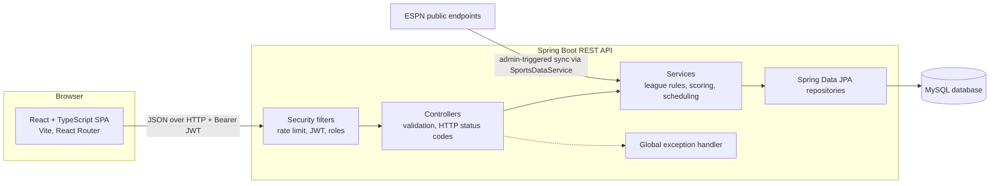
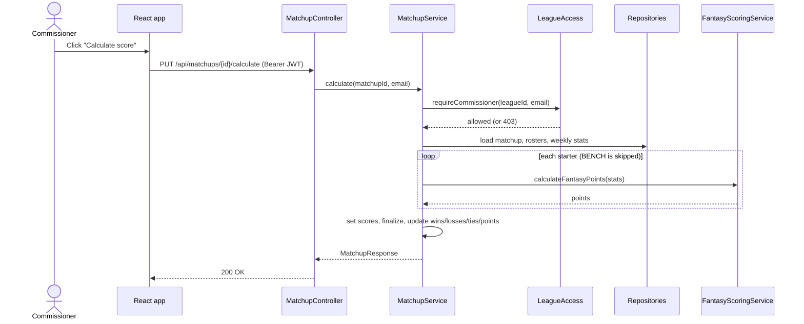
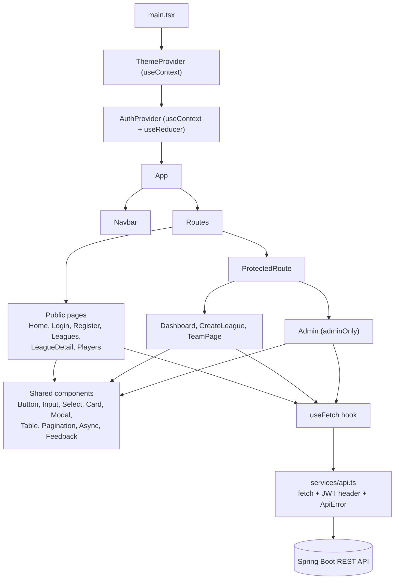

# FantasyZone Architecture

FantasyZone is a three-tier web application: a React single-page app, a Spring Boot REST API, and a MySQL database.
Real-world NFL data comes from an external sports API, but **FantasyZone owns all league logic**: membership, rosters,
matchups, fantasy scoring, records, and standings.

## System architecture


| Layer | Technology | Responsibility |
|---|---|---|
| Frontend | React 18, TypeScript, Vite, React Router | Pages, forms, validation, routing, calling the API |
| Security | Spring Security, JJWT, BCrypt | Stateless JWT login, role checks, rate limiting on auth endpoints |
| Controllers | Spring MVC, Bean Validation | HTTP mapping, `@Valid` request checks, status codes |
| Services | Spring `@Service`, `@Transactional` | All business rules (see below) |
| Persistence | Spring Data JPA, Hibernate, MySQL | Entities, relationships, custom queries, pagination |
| External data | `SportsDataService` interface | Boundary for real-world player and stat data |

## Who owns what
| External API provides | FantasyZone owns |
|---|---|
| NFL players, teams, positions | Users, roles, authentication |
| Weekly raw statistics | Leagues, membership, commissioner powers |
| | Fantasy teams and rosters |
| | Matchup scheduling |
| | Fantasy point conversion |
| | Wins, losses, ties, standings |

Raw stats are stored as-is. Fantasy points are **calculated by `FantasyScoringService`**, never stored, so the scoring
formula can change without rewriting history.

## Scoring (fixed for the first release)
| Stat | Points |
|---|---|
| Passing yard | 0.04 |
| Passing touchdown | 4 |
| Interception | -2 |
| Rushing yard | 0.10 |
| Rushing touchdown | 6 |
| Reception | 1 |
| Receiving yard | 0.10 |
| Receiving touchdown | 6 |
| Fumble lost | -2 |

## Calculating a matchup


## Access model
| Who | Can do |
|---|---|
| Visitor (no login) | Home, league list and detail, league standings, NFL players and stats |
| User (`ROLE_USER`) | Everything a visitor can, plus create/join leagues, create a team, add/drop own players, view league teams, rosters, matchups |
| Commissioner (league membership flag) | Everything a member can, plus remove members, lock rosters, generate matchups, calculate scores for that league |
| Admin (`ROLE_ADMIN`) | Everything, in every league, plus list users and enable/disable accounts |

Commissioner is stored on `league_members`, not as a global role, because a person can commission one league and be an
ordinary member of another. All league-level checks live in one class, `LeagueAccess`.

## React front end


| Route | Access |
|---|---|
| `/`, `/login`, `/register`, `/leagues`, `/leagues/:leagueId`, `/players` | Public |
| `/dashboard`, `/leagues/create`, `/team/:teamId`, `/team/:teamId/roster` | Logged in |
| `/admin` | Admin only |

## Entity-relationship diagram
See [DATABASE.md](DATABASE.md) for the ERD, constraints, and indexes.

## Backend package layout
```
com.fantasyzone
  controller/   REST endpoints
  service/      business logic (LeagueService, TeamService, RosterService, MatchupService,
                StandingsService, FantasyScoringService, AuthService, AdminService, LeagueAccess)
  repository/   Spring Data JPA interfaces
  entity/       JPA entities
  dto/          request/response records
  security/     JWT filter, rate limiter, security configuration
  exception/    custom exceptions and the global handler
  config/       seed data
```
