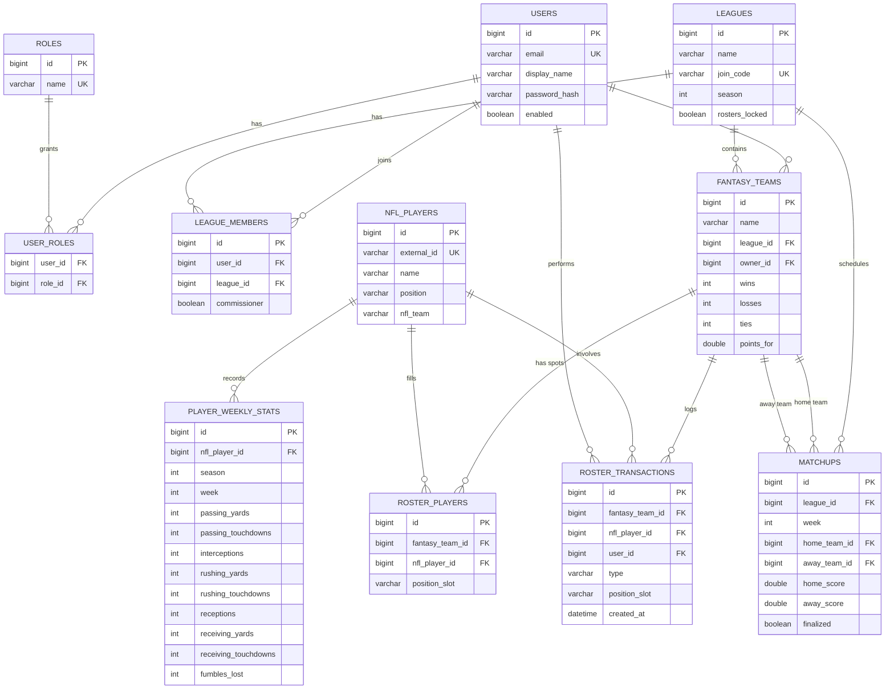

# Database Design

MySQL 8, eleven tables, created from the JPA entities by Hibernate (`ddl-auto=update`). Seed data is inserted at startup by
`DataInitializer` (roles, an admin account, 12 sample NFL players with week 1 stats for season 2025; the sample stat
numbers are made up for demos).

## ERD

## Relationships
| Relationship | Type | How it is modeled |
|---|---|---|
| Users and roles | Many-to-many | `@ManyToMany` with join table `user_roles` |
| Users and leagues | Many-to-many | Bridge entity `league_members` (adds the `commissioner` flag) |
| Teams playing each other | Many-to-many over a season | `matchups` links a home team and an away team (both many-to-one to `fantasy_teams`) |
| League to matchups | One-to-many | `League.matchups` / `Matchup.league` |
| League to teams | One-to-many | `League.teams` / `FantasyTeam.league` |
| Fantasy team to roster spots | One-to-many / many-to-one | `FantasyTeam.roster` / `RosterPlayer.fantasyTeam` |
| NFL player to roster spots and stats | One-to-many | `RosterPlayer.nflPlayer`, `PlayerWeeklyStats.nflPlayer` |
| Fantasy team to roster history | One-to-many | `FantasyTeam.transactions` / `RosterTransaction.fantasyTeam`; every add and drop is logged with the player, slot, who made it, and when |

The three relationship types the course asks for (`@OneToMany`, `@ManyToOne`, `@ManyToMany`) are all used.
Cascading: users, leagues, and teams cascade to their dependent rows (`CascadeType.ALL`, `orphanRemoval`). All
`@ManyToOne` associations are `LAZY`; roles are `EAGER` because security needs them on every request.

## Constraints
| Table | Constraint |
|---|---|
| `users` | `email` UNIQUE, NOT NULL; `password_hash` NOT NULL (BCrypt) |
| `roles` | `name` UNIQUE |
| `leagues` | `join_code` UNIQUE |
| `league_members` | UNIQUE (`user_id`, `league_id`): a user joins a league once |
| `fantasy_teams` | UNIQUE (`league_id`, `name`); UNIQUE (`league_id`, `owner_id`): one team per user per league |
| `nfl_players` | `external_id` UNIQUE |
| `roster_players` | UNIQUE (`fantasy_team_id`, `nfl_player_id`) |
| `player_weekly_stats` | UNIQUE (`nfl_player_id`, `season`, `week`): no duplicate stat lines |
| `matchups` | A team cannot play itself (checked in `@PrePersist`/`@PreUpdate`) |
| `roster_transactions` | `type` is `ADD` or `DROP` (stored as text); append-only; deleted with its team |

Rules enforced in the service layer rather than the database: a player can be on only one team within a league, a
roster holds at most 15 players, and matchups need an even number of teams.

## Indexes
| Table | Index | Used for |
|---|---|---|
| `nfl_players` | `position` | Filtering players by position |
| `nfl_players` | `nfl_team` | Filtering players by NFL team |
| `matchups` | (`league_id`, `week`) | Listing a league's matchups for a week |
| `roster_transactions` | (`fantasy_team_id`, `created_at`) | Showing a team's recent roster history |
| All unique constraints | Implicit unique indexes | Login by email, join by code, duplicate checks |
| All foreign keys | Created by MySQL | Joins |

## Validation annotations
`@NotBlank`, `@Email`, `@Size` on `User`, `League`, and `FantasyTeam`; `@Valid` request records add `@Min`/`@Max`
(season) and password length (8 to 100).
